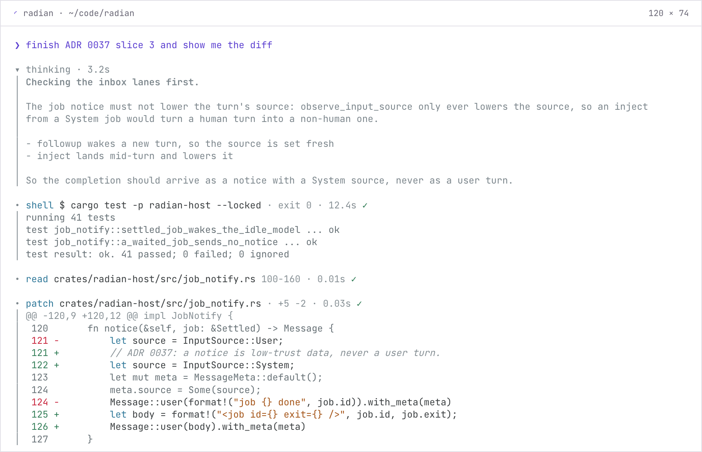

<p align="center">
  <picture>
    <source media="(prefers-color-scheme: dark)" srcset=".github/readme/banner-dark.png">
    
  </picture>
</p>

<p align="center"><b>English</b> | <a href="README.zh-CN.md">简体中文</a></p>

<p align="center">
  <a href="LICENSE-MIT"></a>
  
  
  <a href="https://github.com/hisea/radian/releases"></a>
</p>

# radian

radian is a fast, efficient coding agent in one Rust binary.
Planning, task orchestration, gates and review live in [operad](https://operad.io), which drives radian through `radian exec`.

[radian](#radian-the-coding-agent) · [operad](#operad-planning-and-orchestration) · [Install](#install) · [Docs](#docs)

## radian: the coding agent

- `radian` opens a full-screen terminal UI. `rad` is an alias.
- `radian exec` runs headless. `radian exec -p "<task>"` runs one task and exits. `--output jsonl` prints each step as one JSON line, and the exit code tells how the turn ended.
- Each session is one JSONL journal file. Both modes can resume a session, fork it at a turn boundary, or watch it read-only with `radian attach`.
- Providers: OpenAI-compatible Chat Completions and the Anthropic Messages API. Tools: built-in file, search, shell and job tools, MCP stdio servers, skills, memory, and a one-shot `subagent`.
- It reads what you already have: `AGENTS.md` and `CLAUDE.md`, skills in `~/.agents/skills`, MCP servers in the `mcpServers` format, Claude and Codex style hooks, and pi themes.
- Inside [herdr](https://github.com/ogulcancelik/herdr), radian reports its state (working, idle, blocked) by itself.

<p align="center">
  <picture>
    <source media="(prefers-color-scheme: dark)" srcset=".github/readme/terminal-dark.png">
    
  </picture>
  <br><sub>radian at 120 columns, rendered by the TUI prototype script (<code>research/2026-10-16-render-prototype/</code>).</sub>
</p>

```sh
radian login                          # store a provider key
radian                                # the full-screen app
radian exec -p "summarize Cargo.toml" # one task, headless
```

**Permissions.** The default tier is `full`: no sandbox, and no prompts for the built-in tools.
`--profile workspace` turns the sandbox on (macOS seatbelt or Linux bubblewrap) and confines writes to the workspace.
A project can save `workspace` for itself, and a project setting can only narrow access.
`full` does not defend against prompt injection from an unfamiliar repository: for a boundary use `workspace`, a container, or a dedicated OS user.
Details: [`docs/user/permissions.md`](docs/user/permissions.md).

## operad: planning and orchestration

Planning, task orchestration, gates and review now live in [operad](https://operad.io), a separate program.
operad drives radian through `radian exec`: it starts one headless worker for each task, runs the gate, and merges only what passes.
radian itself stays a coding agent: the terminal interface, `radian exec`, and the tools around them.

## Install

Install the current release from Homebrew, from a release tarball, or from
source with Cargo.

```sh
brew install hisea/tap/radian
```

The tap links only `radian`: homebrew-core already has a `rad` formula, so
this one does not link its `rad` alias. The macOS packages are signed and
notarized.

Or download `radian-<version>-<target>.tar.gz` from the
[releases page](https://github.com/hisea/radian/releases), check it against
its `.sha256`, and unpack the `radian` (and `rad`) binary inside:

```sh
shasum -a 256 -c radian-<version>-<target>.tar.gz.sha256
tar -xzf radian-<version>-<target>.tar.gz
./radian --version
```

Or build from source (this installs both `radian` and `rad`):

```sh
cargo install --git https://github.com/hisea/radian radian-tui
```

On Linux the `workspace` tier runs the sandbox through `bubblewrap`;
install it first (for example `sudo apt install bubblewrap` on Debian
and Ubuntu).

## Docs

New users start with [`docs/user/quickstart.md`](docs/user/quickstart.md); every page of the manual is listed in [`docs/user/index.md`](docs/user/index.md), and it is also at [getrad.dev/docs](https://getrad.dev/docs/).

| What | Where |
|---|---|
| Crates, build, status, configuration and permission reference | [`docs/internals.md`](docs/internals.md) |
| Design of record | [`ARCHITECTURE.md`](ARCHITECTURE.md) |
| Decisions that constrain the code | [`docs/adr/`](docs/adr/) |
| Contributing, security | [`CONTRIBUTING.md`](CONTRIBUTING.md), [`SECURITY.md`](SECURITY.md) |
| Agent instructions (read before changing code) | [`AGENTS.md`](AGENTS.md) |

## License

Licensed under either of [MIT](LICENSE-MIT) or [Apache-2.0](LICENSE-APACHE), at your option. Third-party code and its attribution are listed in [NOTICE](NOTICE).
