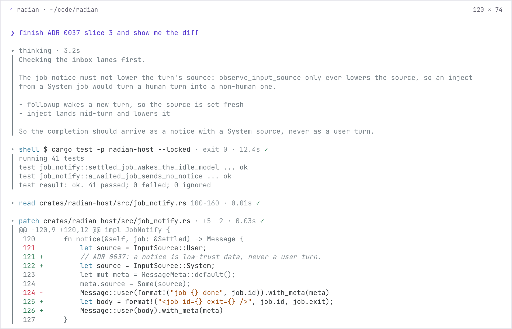
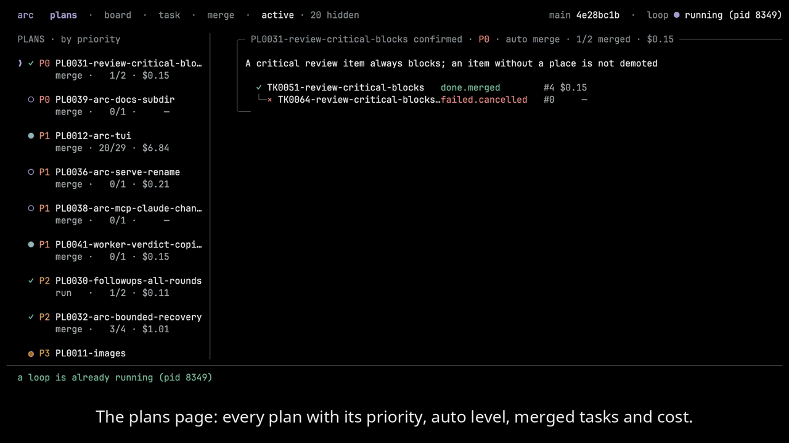
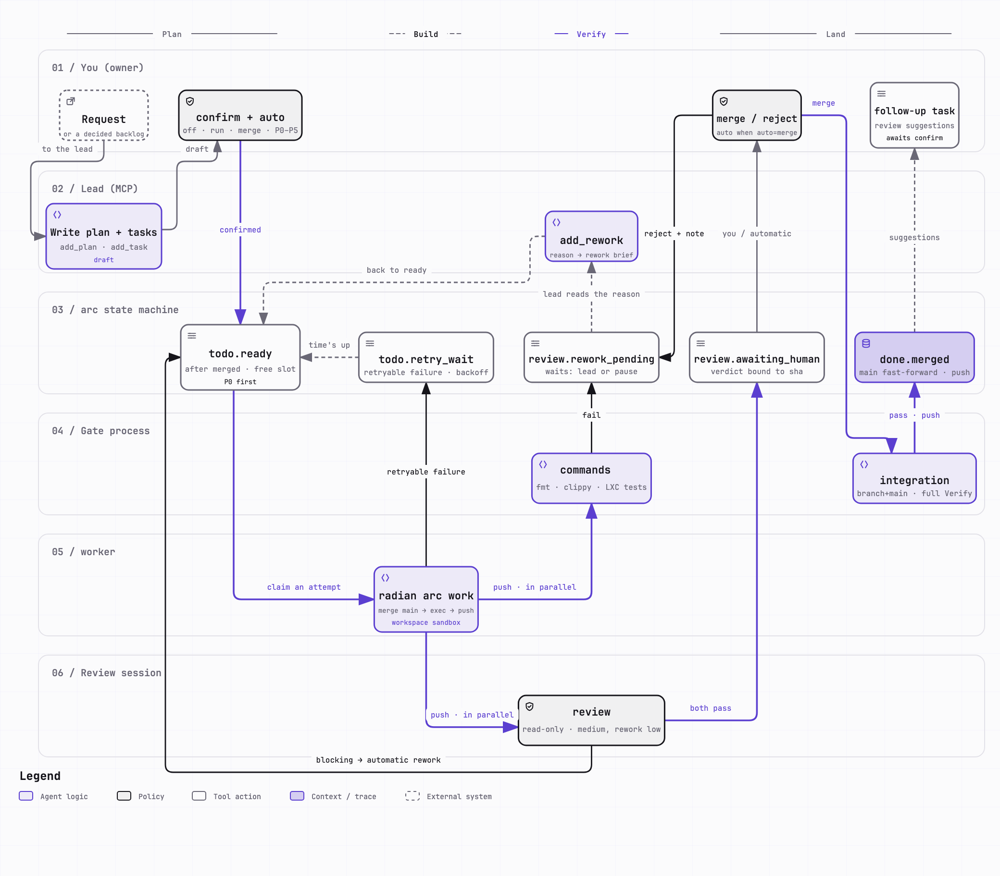

<p align="center">
  <picture>
    <source media="(prefers-color-scheme: dark)" srcset=".github/readme/banner-dark.png">
    
  </picture>
</p>

<p align="center"><b>English</b> | <a href="README.zh-CN.md">简体中文</a></p>

<p align="center">
  <a href="LICENSE-MIT"></a>
  
  
  <a href="https://github.com/hisea/radian/releases"></a>
</p>

# radian

radian is a fast, efficient coding agent in one Rust binary.
Built into the same binary is **arc**, which turns a request into tasks, runs each task with its own radian worker, and merges only what passes a fixed gate.

[radian](#radian-the-coding-agent) · [arc](#arc-the-orchestrator) · [Install](#install) · [Docs](#docs)

## radian: the coding agent

- `radian` opens a full-screen terminal UI. `rad` is an alias.
- `radian exec` runs headless. `radian exec -p "<task>"` runs one task and exits. `--output jsonl` prints each step as one JSON line, and the exit code tells how the turn ended.
- Each session is one JSONL journal file. Both modes can resume a session, fork it at a turn boundary, or watch it read-only with `radian attach`.
- Providers: OpenAI-compatible Chat Completions and the Anthropic Messages API. Tools: built-in file, search, shell and job tools, MCP stdio servers, skills, memory, and a one-shot `subagent`.
- It reads what you already have: `AGENTS.md` and `CLAUDE.md`, skills in `~/.agents/skills`, MCP servers in the `mcpServers` format, Claude and Codex style hooks, and pi themes.
- Inside [herdr](https://github.com/ogulcancelik/herdr), radian reports its state (working, idle, blocked) by itself.

<p align="center">
  <picture>
    <source media="(prefers-color-scheme: dark)" srcset=".github/readme/terminal-dark.png">
    
  </picture>
  <br><sub>radian at 120 columns, rendered by the TUI prototype script (<code>research/2026-10-16-render-prototype/</code>).</sub>
</p>

```sh
radian login                          # store a provider key
radian                                # the full-screen app
radian exec -p "summarize Cargo.toml" # one task, headless
```

**Permissions.** The default tier is `full`: no sandbox, and no prompts for the built-in tools.
`--profile workspace` turns the sandbox on (macOS seatbelt or Linux bubblewrap) and confines writes to the workspace.
A project can save `workspace` for itself, and a project setting can only narrow access.
`full` does not defend against prompt injection from an unfamiliar repository: for a boundary use `workspace`, a container, or a dedicated OS user.
Details: [`docs/user/permissions.md`](docs/user/permissions.md).

## arc: the orchestrator

arc (`radian arc`) is a plan and task orchestrator.
It keeps a plan and its tasks as files in your repository, starts one headless `radian` worker for each task, and merges only what passes the gate.
arc is a program, not a model: a lead session writes the plan, and you decide what runs and what merges.

<p align="center">
  <picture>
    <source media="(prefers-color-scheme: dark)" srcset=".github/readme/arc-en.gif">
    
  </picture>
  <br><sub>The arc TUI on this repository's own backlog: the plans, one task's conversation, brief, diff and attempts, then the board.</sub>
</p>

How a request moves:

<p align="center">
  <picture>
    <source media="(prefers-color-scheme: dark)" srcset=".github/readme/arc-flow-en-dark.png">
    
  </picture>
  <br><sub>One task from request to merge, as this repository runs it: the gate shown (fmt, clippy, tests) is this repository's own.</sub>
</p>


1. A lead (Claude Code or the radian TUI) writes a plan and its tasks through arc's MCP server, `radian arc mcp`. The lead cannot confirm, start or merge anything.
2. You confirm the plan. With the plan's `auto` level at `off` you start each task yourself; at `run` arc starts a task once the tasks it waits for are merged.
3. Each task runs as a separate headless `radian exec` worker, in its own git worktree, on its own branch, with its own session journal.
4. The gate checks the pushed commit: the commands you configure, optionally a read-only review session, and your approval. A failed stage sends the task back for rework.
5. A task that passes is merged into your remote main by `radian arc merge`, or by arc itself when the plan's `auto` level is `merge`. If the branch moved after the gate, the approval is void and the task is verified again.

Every task and plan records its cost, and each can carry a cost and wall-time budget.
The TUI shows the plans, a board that groups open tasks by who acts next (todo, doing, verifying, needs you), each task's conversation, brief, diff and attempts, and the merge page.

```sh
radian arc init                        # in your repository: the layout, and four checks
claude mcp add arc -- radian arc mcp   # register arc with a lead (Claude Code here)
radian arc                             # open the arc TUI
```

arc needs a git working tree with an `origin` remote you can push the main branch to.
`radian arc init` checks the credential, the remote, a dry-run push and the sandbox, and warns about each one that fails.
The gate's commands go in `.radian/arc/config.toml`.
The commands, the gate and the files arc keeps are in [`docs/user/arc.md`](docs/user/arc.md), [`arc-gate.md`](docs/user/arc-gate.md), [`arc-files.md`](docs/user/arc-files.md), [`arc-mcp.md`](docs/user/arc-mcp.md) and [`arc-tui.md`](docs/user/arc-tui.md).

## Install

Install the current release from Homebrew, from a release tarball, or from
source with Cargo.

```sh
brew install hisea/tap/radian
```

The tap links only `radian`: homebrew-core already has a `rad` formula, so
this one does not link its `rad` alias. The macOS packages are signed and
notarized.

Or download `radian-<version>-<target>.tar.gz` from the
[releases page](https://github.com/hisea/radian/releases), check it against
its `.sha256`, and unpack the `radian` (and `rad`) binary inside:

```sh
shasum -a 256 -c radian-<version>-<target>.tar.gz.sha256
tar -xzf radian-<version>-<target>.tar.gz
./radian --version
```

Or build from source (this installs both `radian` and `rad`):

```sh
cargo install --git https://github.com/hisea/radian radian-tui
```

On Linux the `workspace` tier runs the sandbox through `bubblewrap`;
install it first (for example `sudo apt install bubblewrap` on Debian
and Ubuntu).

## Docs

New users start with [`docs/user/quickstart.md`](docs/user/quickstart.md); every page of the manual is listed in [`docs/user/index.md`](docs/user/index.md), and it is also at [getrad.dev/docs](https://getrad.dev/docs/).

| What | Where |
|---|---|
| Crates, build, status, configuration and permission reference | [`docs/internals.md`](docs/internals.md) |
| Design of record | [`ARCHITECTURE.md`](ARCHITECTURE.md) |
| Decisions that constrain the code | [`docs/adr/`](docs/adr/) |
| Contributing, security | [`CONTRIBUTING.md`](CONTRIBUTING.md), [`SECURITY.md`](SECURITY.md) |
| Agent instructions (read before changing code) | [`AGENTS.md`](AGENTS.md) |

## License

Licensed under either of [MIT](LICENSE-MIT) or [Apache-2.0](LICENSE-APACHE), at your option. Third-party code and its attribution are listed in [NOTICE](NOTICE).
