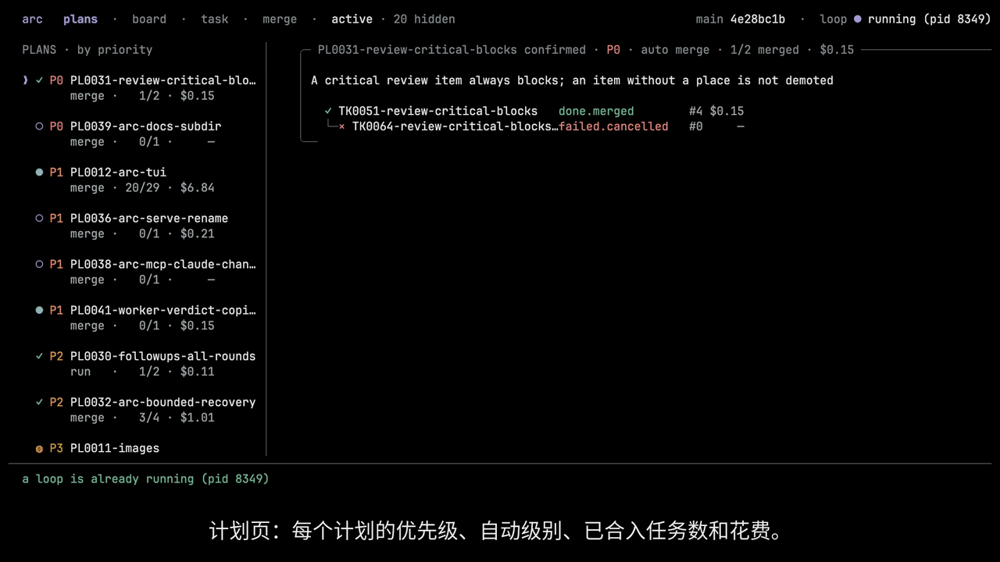

<p align="center">
  <picture>
    <source media="(prefers-color-scheme: dark)" srcset=".github/readme/banner-dark.png">
    
  </picture>
</p>

<p align="center"><a href="README.md">English</a> | <b>简体中文</b></p>

<p align="center">
  <a href="LICENSE-MIT"></a>
  
  
  <a href="https://github.com/hisea/radian/releases"></a>
</p>

# radian

radian 是一个快速、高效的编码 agent，只有一个 Rust 二进制。
同一个二进制里还内置了 **arc**：它把一个需求拆成任务，每个任务交给一个独立的 radian worker 去做，只合并通过固定门禁的结果。

[radian](#radian编码-agent) · [arc](#arc编排器) · [安装](#安装) · [文档](#文档)

## radian：编码 agent

- `radian` 打开全屏终端界面，`rad` 是它的别名。
- `radian exec` 是无头模式。`radian exec -p "<任务>"` 跑一个任务后退出；`--output jsonl` 把每一步输出成一行 JSON，退出码说明这一轮是怎么结束的。
- 每个会话是一个 JSONL 日志文件。两种模式都能恢复会话、在轮次边界分叉会话，也可以用 `radian attach` 只读查看。
- 模型接口：OpenAI 兼容的 Chat Completions 和 Anthropic Messages API。工具：内置的文件、搜索、shell 和 job 工具，MCP stdio 服务器，skills，记忆，以及一次性的 `subagent`。
- 你已有的东西直接能用：`AGENTS.md` 和 `CLAUDE.md`、`~/.agents/skills` 里的 skills、`mcpServers` 格式的 MCP 配置、Claude 和 Codex 风格的 hooks，以及 pi 的主题。
- 在 [herdr](https://github.com/ogulcancelik/herdr) 里，radian 自己上报状态（working、idle、blocked）。

<p align="center">
  <picture>
    <source media="(prefers-color-scheme: dark)" srcset=".github/readme/terminal-dark.png">
    
  </picture>
  <br><sub>radian 在 120 列下的画面，由 TUI 原型脚本渲染（<code>research/2026-10-16-render-prototype/</code>）。</sub>
</p>

```sh
radian login                          # 存一个模型 key
radian                                # 全屏界面
radian exec -p "summarize Cargo.toml" # 无头，跑一个任务
```

**权限。** 默认档位是 `full`：不开沙箱，内置工具也不弹询问。
`--profile workspace` 打开沙箱（macOS seatbelt 或 Linux bubblewrap），写入限制在工作区内。
项目可以为自己保存 `workspace`，而且项目的设置只能收窄权限。
`full` 不防御来自陌生仓库的提示注入：要边界就用 `workspace`、容器或专用的系统用户。
详见 [`docs/user/permissions.md`](docs/user/permissions.md)。

## arc：编排器

arc（`radian arc`）是计划和任务的编排器。
它把计划和任务存成你仓库里的文件，每个任务启动一个无头的 `radian` worker，只合并通过门禁的结果。
arc 是一个程序，不是模型：计划由一个 lead 会话来写，跑什么、合并什么由你决定。

<p align="center">
  <picture>
    <source media="(prefers-color-scheme: dark)" srcset=".github/readme/arc-zh.gif">
    
  </picture>
  <br><sub>arc TUI 跑在这个仓库自己的待办上：计划列表，一个任务的对话、简报、diff 和尝试记录，然后是看板。</sub>
</p>

一个需求是这样走完的：

1. lead（Claude Code 或 radian TUI）通过 arc 的 MCP 服务器 `radian arc mcp` 写计划和任务。lead 不能确认、启动或合并任何东西。
2. 你确认计划。计划的 `auto` 级别是 `off` 时，每个任务由你自己启动；是 `run` 时，arc 会在任务所等的任务合并之后自己启动它。
3. 每个任务是一个独立的无头 `radian exec` worker，有自己的 git worktree、自己的分支和自己的会话日志。
4. 门禁检查推上来的提交：你配置的命令、可选的只读 review 会话，以及你的批准。某个阶段失败，任务就退回去返工。
5. 通过的任务由 `radian arc merge` 合并进远端 main；计划的 `auto` 级别是 `merge` 时由 arc 自己合并。门禁之后分支又动过的话，批准作废，任务重新验证。

每个任务和计划都记录自己的花费，也都可以设花费和耗时的预算。
TUI 里能看到计划列表、按“下一步由谁来做”分组的看板（待办、进行中、验证中、需要你处理）、每个任务的对话、简报、diff 和尝试记录，以及合并页。

```sh
radian arc init                        # 在你的仓库里：建好目录，并做四项检查
claude mcp add arc -- radian arc mcp   # 把 arc 注册给 lead（这里是 Claude Code）
radian arc                             # 打开 arc TUI
```

arc 需要一个 git 工作区，并且有一个你能往 main 分支推送的 `origin` 远端。
`radian arc init` 会检查凭据、远端、一次试推送和沙箱，哪一项失败就给一行警告。
门禁要跑的命令写在 `.radian/arc/config.toml` 里。
命令、门禁和 arc 保存的文件见 [`docs/user/arc.md`](docs/user/arc.md)、[`arc-gate.md`](docs/user/arc-gate.md)、[`arc-files.md`](docs/user/arc-files.md)、[`arc-mcp.md`](docs/user/arc-mcp.md) 和 [`arc-tui.md`](docs/user/arc-tui.md)（用户手册是英文）。

## 安装

用 Homebrew、release 压缩包或 Cargo 从源码安装当前版本。

```sh
brew install hisea/tap/radian
```

这个 tap 只链接 `radian`：homebrew-core 里已经有一个 `rad` formula，所以这里不链接自带的 `rad` 别名。macOS 的包经过签名和 notarization。

或者从[发布页](https://github.com/hisea/radian/releases)下载 `radian-<version>-<target>.tar.gz`，用同名的 `.sha256` 校验后，解开里面的 `radian`（和 `rad`）：

```sh
shasum -a 256 -c radian-<version>-<target>.tar.gz.sha256
tar -xzf radian-<version>-<target>.tar.gz
./radian --version
```

或者从源码构建（会同时装上 `radian` 和 `rad`）：

```sh
cargo install --git https://github.com/hisea/radian radian-tui
```

在 Linux 上，`workspace` 档位用 `bubblewrap` 跑沙箱；先把它装好（Debian/Ubuntu 上比如 `sudo apt install bubblewrap`）。

## 文档

新用户从 [`docs/user/quickstart.md`](docs/user/quickstart.md) 开始；手册的每一页都列在 [`docs/user/index.md`](docs/user/index.md)，也可以在 [getrad.dev/docs](https://getrad.dev/docs/) 看（用户手册是英文）。

| 内容 | 位置 |
|---|---|
| crate、构建、状态、配置和权限参考 | [`docs/internals.zh-CN.md`](docs/internals.zh-CN.md) |
| 设计 | [`ARCHITECTURE.md`](ARCHITECTURE.md) |
| 约束代码的决策 | [`docs/adr/`](docs/adr/) |
| 贡献、安全 | [`CONTRIBUTING.md`](CONTRIBUTING.md)、[`SECURITY.md`](SECURITY.md) |
| Agent 指令（改代码前先读） | [`AGENTS.md`](AGENTS.md) |

## 许可证

按你的选择，使用 [MIT](LICENSE-MIT) 或 [Apache-2.0](LICENSE-APACHE) 之一授权。第三方代码及其署名列在 [NOTICE](NOTICE)。
