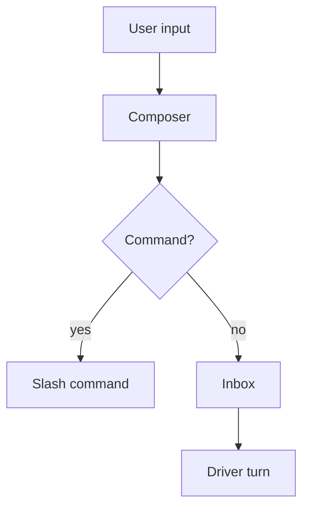
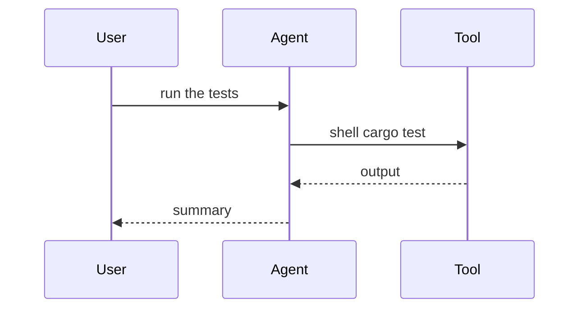
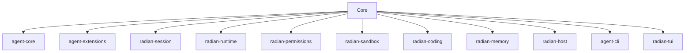

# Diagrams in Radian

Radian renders a fenced ```` ```mermaid ```` block with a **bounded** renderer: a `flowchart`/
`graph` is drawn by Radian's own **layered layout**, and every other family — plus the few
flowcharts that layout cannot draw — by the vendored `codex-mermaid`. Either way it is a
deliberate subset, not full Mermaid. Verify every diagram with the `mermaid_check` tool before
you answer; do **not** read the renderer source, compile its example, or measure widths by hand
— that is exactly what this skill exists to avoid.

## Workflow

1. Write the diagram from the notes below.
2. Call `mermaid_check { "source": "…" }` (optionally `"width": 100`).
3. If it fails, the tool names the reason (`unsupported`, `limit`, `too_wide`) and a fix. Fix and
   check again.
4. Only then put the diagram in your answer, inside a ```` ```mermaid ```` fence.

## What is supported

| Family | Header | Notes |
|---|---|---|
| Flowchart | `flowchart TD` (also `graph`, and `TB`/`BT`/`LR`/`RL`) | rectangle `A[label]`, decision `A{label}`, stadium `A([label])`; solid `-->`/`---`/`<-->`, dashed `-.->`/`-.-`; pipe labels `A -->|text| B` and infix `A -- text --> B`; `&` fan-out/fan-in; chains, branches, merges, loops |
| Sequence | `sequenceDiagram` | `participant`/`actor`, aliases (`participant A as Alice`), `->`, `->>`, `-->`, `-->>`, `-x`, `--x`, self-messages, `Note over A[,B]`, nested `loop`/`alt`/`opt`/`critical`/`break`, one labeled `else` per `alt` |
| State | `stateDiagram-v2` (or `stateDiagram`) | flat states, `state "label" as ID`, descriptions, directed transitions with optional labels, `[*]` initial/final |
| Class | `classDiagram` | `class ID`, member bodies (one member per line), `ID : member`, solid/dashed links, inheritance/realization/composition/aggregation/dependency, quoted cardinalities, labels |
| ER | `erDiagram` | entities, attribute bodies (`type name [PK, FK, UK] ["comment"]`), `1`/`0..1`/`1..many`/`0..many`, identifying (solid) and non-identifying (dashed) relationships |

Identifiers: ASCII letter first, then letters/digits/`_`. Labels may be double-quoted; quotes
protect `[ ] | ;`. Full-line `%%` comments and `;`-separated statements are supported (outside
flowchart labels, quoted tokens and class bodies).

## Hard limits (Radian's current version — recheck if the renderer is upgraded)

- Source: **16 KiB**.
- Flowchart/state/class/ER: **16 nodes**, **24 edges** (after `&` expansion), **16 members per
  node**, one `&` group at most **24** references.
- Sequence: **8 participants**, **64 events** (fragment boundaries count), **4 nested fragment
  levels**.
- Any label or identifier: **40** display cells (identifiers: 40 ASCII bytes).
- Canvas: **65 536** cells.
- Over any of these → `limit`. The complete diagram must fit the width → otherwise `too_wide`.
- **No partial output ever.** On any error the caller keeps the source; that is why you check.

## Unsupported (returns `unsupported`)

`subgraph` / compound states, `autonumber`, other node shapes (`((circle))`, `[[…]]`, `{{…}}`),
sequence activation (`activate`/`deactivate`) and `par`, styling (`classDef`, `style`, `linkStyle`),
front matter, `%%{init}%%` directives, HTML, entity escapes, combining/zero-width characters and
ligatures with non-additive widths. `<br>` is **not** a line break; put each member on its own line.

## How to make it look good in a terminal

- A `flowchart` is laid out in **layers** — the longest path from the sources — and every layer
  is centred in the canvas. A node is a **one-row-high box**, and two nodes of adjacent layers
  are joined by a **straight line with an arrowhead** through the middle of both (the boxes' sides
  in `LR`/`RL`).
- A layer with several nodes gets one **bus row**: each edge leaves its box's middle and the
  edges merge or split on one line, so a fan-out or a merge reads as a single fork instead of a
  band of crossings.
- An edge that **skips a layer**, and one that points **back** (a loop), wraps in a channel
  **outside the canvas** rather than crossing a box. An edge's label (`A -->|yes| B`) is drawn
  beside its line, and the canvas widens if the label needs the room.
- **Avoid the star**: one central node with 8+ edges makes one layer of eight boxes and a very
  wide bus row. Split it into several small diagrams (one per concern), or describe the layers in
  prose and diagram one layer at a time.
- One diagram, one topic: **5–8 nodes**. Prefer `flowchart TD` for structure, and
  `sequenceDiagram` for **flows and interactions** (it reads far better than a chain of arrows).
- `LR`/`RL` are one box per layer and get wide fast; use `TD`/`TB` unless you know the graph is
  small.
- CJK and other wide characters count as **2 cells**; a 40-cell label fits about 20 CJK characters.
- Keep labels short and concrete; move detail into the prose around the diagram.
- A few flowcharts still fall back to the vendored renderer's own shape (one column, a lane per
  edge): a **self-loop** (`A --> A`), an edge marked at its source (`A <--> B`), a **labelled**
  edge that skips a layer, and any diagram whose layers do not fit the width. Nothing is lost,
  but those read worse — prefer the shapes above when the look matters.

## A good example



Five nodes, one branch, no crossings. A sequence version of a flow is often even clearer:



## A bad example (do not do this)



Eleven edges from one node: in the terminal this is a single column of boxes with a large band of
crossing lines on the right — technically correct, unreadable. Split it into a small dependency
diagram per layer, or a `flowchart TD` of the layers (`Core → host → binaries`) and prose for the
rest.
